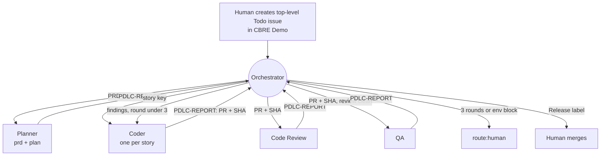

# Orchestrated mode (PDLC)

A second way to run the same pipeline. A workstream orchestrator watches
Linear and GitHub, starts one agent per step, and routes each result. Agents
report only to the orchestrator; they never hand off to each other. Findings
from Code Review and QA go back to the same Coder agent, at most 3 fix rounds
per story. A human merges.

The stage logic is unchanged. Agents load the `prd-to-pr-demo` skill and
apply the overrides in `.factory/skills/prd-to-pr-demo/orchestrated.md`. The
Linear project is `CBRE Demo`, not `Demo`.

## Agents

| Agent | Stage | Target | Writes |
| --- | --- | --- | --- |
| Planner | `prd`, then `plan` | PRD key | `## Structured PRD`, stories, `## Stories` |
| Coder | `dev`, then fix rounds | Story key | Branch, PR, `## Pull Request`, `## Fix Loop #n` |
| Code Review | `review` | PR number and head SHA | `<!-- code-review -->` comment, `bug` |
| QA | `qa` | PR number and head SHA | `<!-- qa-report -->` comment, `bug`, `Release`, or `route:human` |

Every agent ends with a `PDLC-REPORT` block. The orchestrator checks Linear
and GitHub before acting on it.

## Start the demo

1. Keep the old `Demo · ...` automations paused.
2. Create a top-level issue in the Linear project `CBRE Demo` (team `SED`),
   state `Todo`. A plain-language request is enough. Add `Experiment` to see a
   fix loop.
3. Unpause the orchestrator's wake-up automation. On its next run it picks up
   the issue and starts a Planner.

## Reset

1. Pause the wake-up automation.
2. Close the demo pull requests on GitHub and delete their `story/*`
   branches.
3. In Linear, cancel or archive the demo issue and its stories.
4. Clear the issue's entries from the orchestrator's `pdlc/state.json`.
